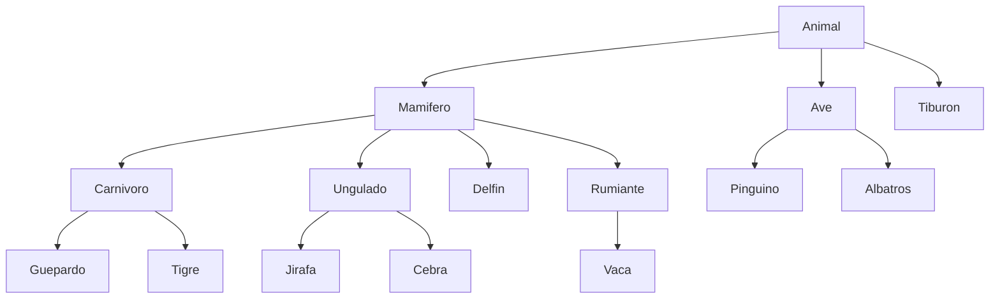
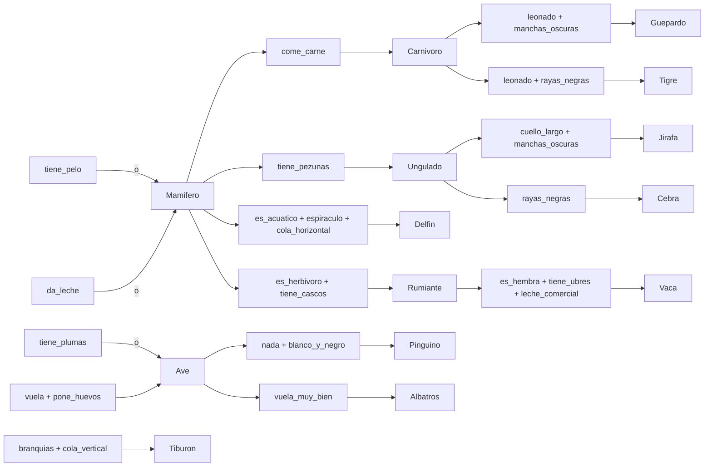

# Ontología de clasificación de animales

Programación Lógica – Grupo 7SE
Estrada Domínguez Arturo · Lagunas Rodriguez Marco Antonio

## Jerarquía de clases

## Reglas y condiciones de cada clase

## Tabla de reglas

| # | Condiciones | Conclusión | Fuente |
|---|-------------|------------|--------|
| 1 | tiene_pelo | mamífero | Ana Torres |
| 2 | da_leche | mamífero | Ana Torres |
| 3 | tiene_plumas | ave | Ana Torres |
| 4 | vuela, pone_huevos | ave | Ana Torres |
| 5 | mamífero, come_carne | carnívoro | Ana Torres |
| 6 | mamífero, tiene_pezuñas | ungulado | Ana Torres |
| 7 | carnívoro, color_leonado, manchas_oscuras | guepardo | Ana Torres |
| 8 | carnívoro, color_leonado, rayas_negras | tigre | Ana Torres |
| 9 | ungulado, cuello_largo, manchas_oscuras | jirafa | Ana Torres |
| 10 | ungulado, rayas_negras | cebra | Ana Torres |
| 11 | ave, nada, blanco_y_negro | pingüino | Ana Torres |
| 12 | ave, vuela_muy_bien | albatros | Ana Torres |
| 13 | mamífero, es_acuático, espiráculo, cola_horizontal | delfín | Entrevista 1 |
| 14 | branquias, cola_vertical | tiburón | Entrevista 1 |
| 15 | mamífero, es_herbívoro, tiene_cascos | rumiante | Entrevista 2 |
| 16 | rumiante, es_hembra, tiene_ubres, leche_comercial | vaca | Entrevista 2 |

## Casos de las entrevistas

| Animal | Hechos observados | Cadena inferida |
|--------|-------------------|-----------------|
| Delfín | da_leche, es_acuatico, aleta_dorsal, cola_horizontal, espiraculo, sube_a_respirar | delfín → mamífero → animal |
| Tiburón | es_acuatico, aleta_dorsal, branquias, cola_vertical | tiburón → animal |
| Vaca | tiene_pelo, da_leche, es_herbivoro, tiene_cascos, tiene_pezunas, es_hembra, tiene_ubres, leche_comercial | vaca → rumiante → mamífero → animal |

## Diferencias clave entre animales confundibles

- **Delfín vs tiburón:** el delfín respira por espiráculo y tiene cola horizontal; el tiburón tiene branquias y cola vertical.
- **Vaca vs toro/buey:** la vaca es hembra, tiene ubres desarrolladas y produce leche.
